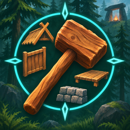

# SonicWorldTools



**A collection of Infinity Hammer tools for building, terrain editing, prop placement, and selection.**

SonicWorldTools adds menu tools to Infinity Hammer's Hammer, Hoe, and Cultivator. It does not add a separate hammer item. Each tool is described below with its purpose, controls, and important limits.

## At a glance

| Infinity Hammer menu | Tool | Use it to |
| --- | --- | --- |
| Hammer | Line Tool | Repeat a sampled piece along straight or curved routes. |
| Hammer | Shape Tool | Place a sampled piece around a circle, square, or rectangle, with optional infill. |
| Hammer | Precision Select | Select, refine, copy, dismantle, or delete building pieces in a three-corner volume. |
| Hoe | Surface Paths | Paint grass, dirt, cultivated soil, or paved terrain along a route. |
| Hoe | Lower Terrain | Lower and optionally smooth the ground in the Hoe's area cursor. |
| Cultivator | Scatter Props | Scatter a mix of sampled networked props across a circular area. |

## Tool guide

Select a tool from its Infinity Hammer menu to activate it. Controls below are the defaults; most keys can be changed in `BepInEx/config/com.sonicdm.valheim.sonicworldtools.cfg`.

### Hammer: Line Tool

Repeat a supported build piece along a straight or curved route. Common examples include fences, walls, beams, lamps, floors, and props with a reviewed placement profile.

1. Select **Line Tool** from Infinity Hammer's Hammer tools.
2. Aim at a placed piece and **middle-click** to sample it.
3. **Click** each route waypoint. The preview shows the repeated pieces along the route.
4. Hold **Shift** and click to place the batch. Use Infinity Hammer's undo to reverse it.

| Control | Default action |
| --- | --- |
| Middle-click | Sample the aimed placed piece. |
| Click | Add a route waypoint. |
| Right Alt+click | Snap a waypoint to the aimed piece's repeat joint. |
| Shift+click | Place the previewed route. |
| Mouse wheel | Rotate the repeated pieces. |
| Alt+mouse wheel | Increase or decrease the gap between pieces. |
| Hold Alt | Keep the route at one height. |
| F7 / Shift+F7 | Open route settings / edit the sampled-piece offsets. |
| Esc | Exit Line Tool. |

The first sampled placement uses Valheim's build snapping; **Q/E** cycles its snap point. Repeated pieces use editable profiles in `BepInEx/config/SonicWorldTools/PrefabPlacement/VanillaPieces.yml`. A piece without a reviewed, enabled profile cannot be placed. At bends, the route solver may overlap adjacent pieces to close an outside gap; very tight turns may need another waypoint or a spacing adjustment.

For unrestricted world objects, enter `sonic_line_anarchy on` in the console. While enabled, middle-click can sample networked prefabs such as trees and creatures. Placement sends network spawn requests and uses the configured ground-prop spacing instead of build-piece profiles or snapping. Turn the mode off with `sonic_line_anarchy off`. Targets need a `ZNetView`; local-only effects are not created, and Infinity Hammer undo is not guaranteed for spawned batches.

F7 settings choose the curve interpolation. **Current** uses tangent-limited Hermite curves; **Centripetal** passes through the waypoints with centripetal Catmull–Rom. The smoothing-distance setting applies only to Current. Other settings include gap, height behavior, fill-down, and offsets.

### Hammer: Shape Tool

Use Shape Tool to place a sampled piece around a closed circle, square, or rectangle, or fill the enclosed area.

1. Select **Shape Tool** and middle-click a placed build piece to sample it.
2. Click the shape's center, then move the cursor to size the preview.
3. Press **Q** to cycle **Circle → Square → Rectangle**. For a square, the cursor direction also sets its angle.
4. Press **I** to cycle the fill layout: outline only, grid infill, and concentric infill. Circles cycle between outline and concentric infill.
5. Hold **Shift** and click to place the preview.

Circle infill uses concentric rings. Square and rectangle infill can use either a fitted grid or nested concentric rings; use **I** to choose. Square and rectangle perimeters also fit to the sampled piece spacing so the sides meet at the corners. Holstering the hammer or opening the piece-selection menu cancels an unfinished shape.

Concentric square and rectangle infill starts with rings packed to the sampled piece's crosswise width. Hold **Shift** and scroll to widen or tighten the ring spacing in 0.1 m steps. If the requested shape exceeds the 512-placement safety limit, increase the ring spacing or make the shape smaller.

### Hammer: Precision Select

Use Precision Select to select building pieces inside a three-corner volume, then refine, copy, dismantle, or delete that selection.

1. Click **Corner A**.
2. Click **Corner B** to set the width direction and span.
3. Click **Corner C** to set the remaining depth and height. The selected count and volume dimensions appear in the HUD.
4. Refine or act on the locked selection using the controls below.

| Control | Default action |
| --- | --- |
| Left-click | Set A, B, C; after locking, resize from A/B. |
| Alt+left-click | Add the aimed piece to the selection, even outside the volume. |
| Alt+middle-click | Exclude the aimed piece. |
| Shift+middle-click | Hand the selection to Infinity Hammer's copy-placement ghost. |
| Ctrl+Delete | Dismantle selected pieces and return materials. |
| Shift+Delete | Permanently delete selected pieces without drops. |
| Backspace | Clear manual add/exclude refinements, keeping the volume. |
| Home | Clear the corners and start a new volume. |
| Esc | Cancel and clear the current selection. |

Selection padding, box/corner markers, highlights, selected count, and dimensions are configurable. Padding defaults to 0.1 m on each side.

### Hoe: Surface Paths

Choose one of the surface path tools under **Hoe**, then click the route points. Hold **Shift** on the final point to finish; also hold **Alt** on that final click to soften the path edges. The mouse wheel changes the path half-width. The default half-width is 2 m, so the full path is 4 m wide.

| Tool | Surface painted |
| --- | --- |
| Grass Path | Grass |
| Grass Patches Path | Scattered grass patches |
| Dark Grass Path | Dark grass |
| Dirt Path | Dirt |
| Cultivated Path | Cultivated soil |
| Paved Path | Paved stone |
| Mossy Paved Path | Mossy paved stone |
| Dark Paved Path | Dark paved stone |

Finish and smoothing keys are configurable in the `TerrainPaths` section. These tools paint terrain surfaces; they do not place build pieces.

### Hoe: Lower Terrain

Select **Lower Terrain** and use the Hoe's terrain area cursor over the ground to lower it by the selected height amount. The starting amount is 0.2 m. Hold Infinity Hammer **Modifier 1** to smooth the lowered area; hold **Modifier 2** for free placement. The initial amount and smoothing strength are configurable under `LowerTerrain`.

### Cultivator: Scatter Props

Scatter one or more sampled networked props across a circular area.

1. Select **Scatter Props** under Cultivator.
2. Middle-click a networked prop to add it to the sample mix. Middle-click a sampled prop again to remove that type.
3. Click the ground to scatter the mix inside the shown radius. If the sample list is empty, the prop under the cursor is used.
4. Hold **Shift** and middle-click to clear the sample list.

Hold **Alt** and use the mouse wheel to change the number placed per click by one. The count ranges from 1–200 and appears in the tool description. Defaults are 20 props per click, up to 8 sample types, and a 3 m radius. Infinity Hammer's radius binding still controls the radius wheel. These values are configurable under `ScatterProps`.

## Install

Install with a Valheim mod manager, or place `SonicWorldTools.dll` in `BepInEx/plugins`. Start a world and open Infinity Hammer's Hammer, Hoe, or Cultivator menu to find the tools.

**Dependencies:** BepInExPack Valheim 5.4.2360 and Jötunn 2.30.2. To use the menu tools and their world-editing features, also install compatible versions of Infinity Hammer, World Edit Commands, and Server Devcommands. Those integrations are detected at runtime; the plugin can load without Infinity Hammer, but its menu tools will not be available.

SonicWorldTools creates its own `infinity_tools_sonicworldtools.yaml` under `BepInEx/config/tools/`. It does not edit Infinity Hammer's `infinity_tools.yaml`.

## Tune it

The main settings file is `BepInEx/config/com.sonicdm.valheim.sonicworldtools.cfg`.

| Section | Controls |
| --- | --- |
| `LineTool` | Controls, gap, curve algorithm and smoothing, height, prop facing and spacing, and optional diagnostics. Previous `PieceRepeater` settings migrate on startup. |
| `TerrainPaths`, `LowerTerrain` | Path width, edge smoothing and keys; initial lowering amount and smoothing. Path key changes regenerate the owned Infinity Hammer YAML. |
| `ScatterProps` | Sample and clear keys, palette limit, amount per click, and initial radius. |
| `PrecisionAreaPipette`, `Preview` | Selection controls, padding, and visual feedback. |
| `Integration`, `Debug` | Infinity Hammer tool installation and diagnostic logging. `VerboseLogging` defaults to off. |

Changes to relevant settings refresh the generated tool YAML. Infinity Hammer may need you to reselect the tool or restart the game before its menu shows the new description. If you edit that generated YAML yourself, the plugin keeps your changes and writes its newer template to `BepInEx/config/infinity_tools_sonicworldtools.yaml.new` for comparison.

Line Tool profiles live in `BepInEx/config/SonicWorldTools/PrefabPlacement/VanillaPieces.yml`. They hold each piece's repeat geometry, ground offset, and enabled status. Existing edits survive catalog refreshes; newly discovered build pieces are appended. A `NeedsReview` profile stays disabled until its geometry is corrected. Profile YAML edits reload automatically. Use `sonic_piece_catalog_refresh` after adding building mods, or `sonic_piece_geometry_dump` to inspect a piece's measured geometry. The embedded release defaults come from [the source catalog](src/SonicWorldTools/Resources/PrefabPlacement/VanillaPieces.yml).

## Remove or reset

Removing the plugin leaves its Infinity Hammer tool definition and profile settings on disk. For a clean reset, close Valheim and remove the plugin's files from the profile:

```text
BepInEx/plugins/SonicWorldTools.dll
BepInEx/plugins/SonicWorldTools/SonicWorldTools.dll
BepInEx/scripts/SonicWorldTools.dll       (DEV ScriptEngine installs only)
BepInEx/config/com.sonicdm.valheim.sonicworldtools.cfg
BepInEx/config/SonicWorldTools/
BepInEx/config/tools/infinity_tools_sonicworldtools.yaml
BepInEx/config/infinity_tools_sonicworldtools.yaml      (older installs)
BepInEx/config/infinity_tools_sonicworldtools.yaml.new  (if present)
```

Back up `VanillaPieces.yml` first if you tuned piece profiles. If enabled, Line Tool diagnostics are in `BepInEx/logs/SonicWorldTools-LineTool.log`.

## Development

Build with `.\build.ps1`; run tests with `dotnet test SonicWorldTools.sln`. For ScriptEngine iteration, use `..\tools\dev.ps1 deploy -Mod SonicWorldTools -ProfileBepInEx <DEV profile BepInEx path>`. Before publishing, complete the [in-game test matrix](docs/test-matrix.md).
